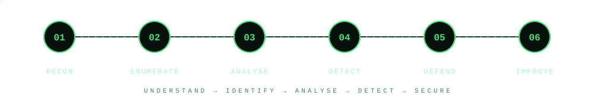

<p align="center">
  
</p>

<p align="center">
  <code>[</code> <a href="https://www.linkedin.com/in/ayush20418">linkedin</a> <code>]</code>&nbsp;&nbsp;
  <code>[</code> <a href="mailto:ayushmaths928@gmail.com">email</a> <code>]</code>&nbsp;&nbsp;
  <code>[</code> <a href="https://drive.google.com/file/d/1pReKO-2RsFySfxPRLx7r-T75KEnMi-is/view?usp=drive_link">resume</a> <code>]</code>&nbsp;&nbsp;
  <code>[</code> <a href="https://github.com/anniayush">github</a> <code>]</code>
</p>

## `01` &nbsp;whoami

> I am a technology enthusiast focused on **cybersecurity, artificial intelligence and practical software**. I like understanding how systems work, and where they break, so that what I build can hold up.

## `02` &nbsp;status board

```text
MODULE                              STATUS
──────────────────────────────────  ─────────────
cybersecurity.ethical_hacking       [ EXPLORING  ]
network_security.web_appsec         [ LEARNING   ]
vulnerability.threat_detection      [ INTERESTED ]
cryptography.secure_comms           [ EXPLORING  ]
hardware_security.fpga              [ WORKING ON ]
ai_ml.applications                  [ BUILDING   ]
backend.system_design               [ LEARNING   ]
dsa.java                            [ PRACTISING ]
```

## `03` &nbsp;attack surface

```text
security/
├── offensive/
│   ├── ethical_hacking_fundamentals
│   ├── penetration_testing_concepts
│   ├── web_application_security
│   ├── owasp_top_10
│   ├── vulnerability_assessment
│   └── security_testing
├── defensive/
│   ├── network_security_fundamentals
│   ├── security_monitoring
│   ├── log_analysis
│   ├── threat_detection
│   ├── incident_response_concepts
│   └── system_hardening
├── cryptography/
│   ├── aes_encryption
│   ├── symmetric_cryptography
│   ├── asymmetric_cryptography
│   ├── hashing_fundamentals
│   └── secure_data_transmission
└── hardware/
    ├── fpga_security
    ├── hardware_trojan_detection
    ├── power_side_channel_analysis
    ├── aes_128_implementation
    └── ml_based_detection
```

## `04` &nbsp;workflow



## `05` &nbsp;case files

### CASE 001 &nbsp;·&nbsp; Hardware Trojan Detection

`CLASS: hardware security` &nbsp; `STATUS: active` &nbsp; `STACK: python · verilog · fpga · aes-128 · ina219 · ml`

An FPGA-based project that detects potential hardware Trojans by analysing power consumption and applying machine learning. The idea is that extra malicious logic leaves a measurable footprint in a chip's power signature.

- AES-128 encryption on FPGA
- INA219 power monitoring and data collection
- Hardware power signature analysis
- ML-based Trojan classification

**[ open repo → ](https://github.com/anniayush/HardwareTrojanML)**

### CASE 002 &nbsp;·&nbsp; Gastric Sentinel

`CLASS: medical ai` &nbsp; `STATUS: active` &nbsp; `STACK: resnet50 · scikit-learn · random forest · pandas · numpy`

An AI-powered project that supports gastric cancer detection by combining medical image analysis with clinical and genomic information.

- ResNet50 image classification
- Clinical and genomic data integration
- Image and clinical/genomic model fusion
- Gastric cancer subtype classification

**[ open repo → ](https://github.com/anniayush/GastricSentinel)**

## `06` &nbsp;loaded modules

<p align="center">
  &nbsp;&nbsp;&nbsp;
  &nbsp;&nbsp;&nbsp;
  &nbsp;&nbsp;&nbsp;
  &nbsp;&nbsp;&nbsp;
  &nbsp;&nbsp;&nbsp;
  &nbsp;&nbsp;&nbsp;
  &nbsp;&nbsp;&nbsp;
  &nbsp;&nbsp;&nbsp;
  &nbsp;&nbsp;&nbsp;
  
  <br><br>
  &nbsp;&nbsp;&nbsp;
  &nbsp;&nbsp;&nbsp;
  &nbsp;&nbsp;&nbsp;
  &nbsp;&nbsp;&nbsp;
  &nbsp;&nbsp;&nbsp;
  &nbsp;&nbsp;&nbsp;
  &nbsp;&nbsp;&nbsp;
  &nbsp;&nbsp;&nbsp;
  &nbsp;&nbsp;&nbsp;
  
</p>

```toml
# modules.lock
languages = ["python", "java", "javascript", "html", "css"]
backend   = ["node.js", "django", "flask", "react", "angular", "vue"]
ai_ml     = ["pytorch", "tensorflow", "scikit-learn", "pandas", "numpy"]
data      = ["mongodb", "mysql", "postgresql", "firebase"]
cloud     = ["aws", "gcp"]
devops    = ["docker", "kubernetes", "git", "github", "linux", "postman"]
exploring = ["kali linux", "wireshark", "burp suite", "nmap", "metasploit"]
```

## `07` &nbsp;telemetry

<p align="center">
  
  
</p>

## `08` &nbsp;connect

```text
$ ./connect --secure
[+] open to collaborations, internships and conversations
[+] topics: security · ai · backend engineering
```

<p align="center"><i>"The best defense begins with understanding how things work."</i></p>


